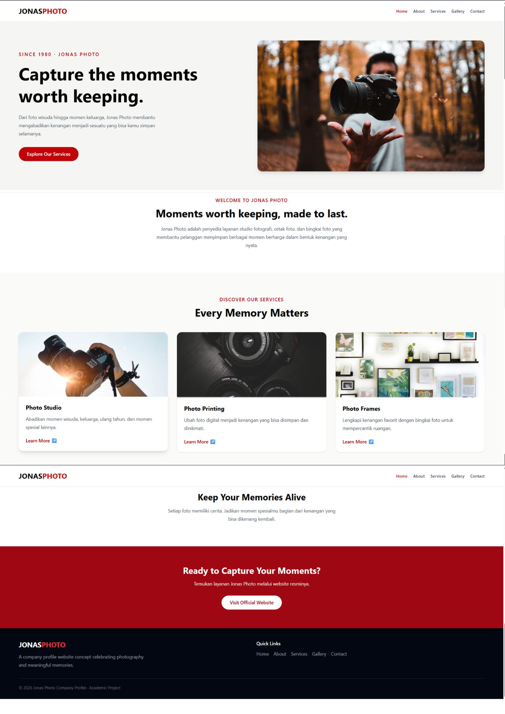
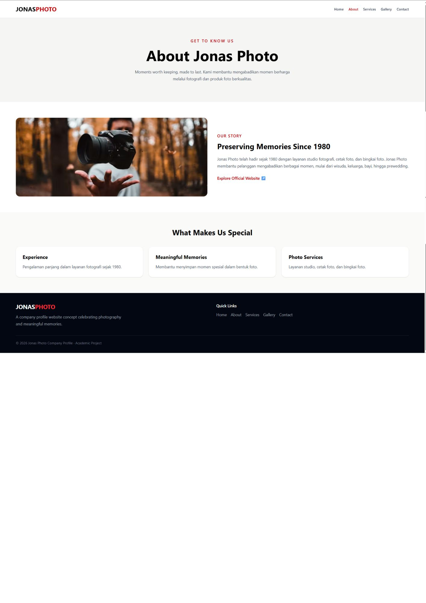
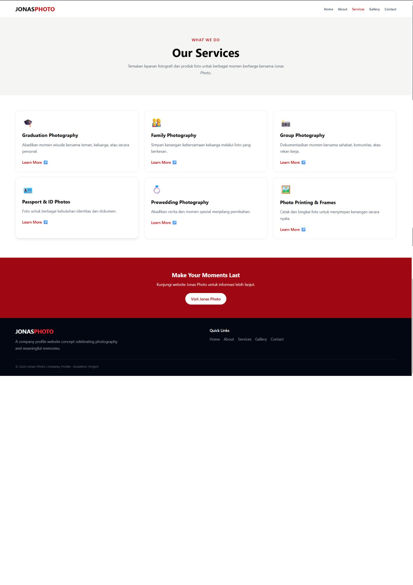
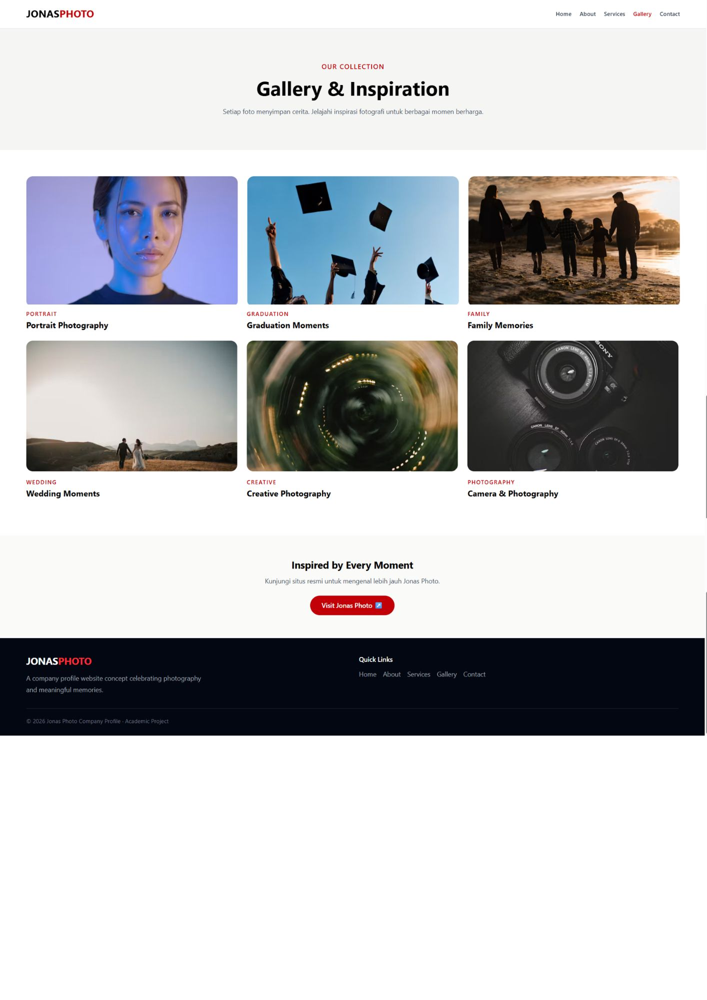
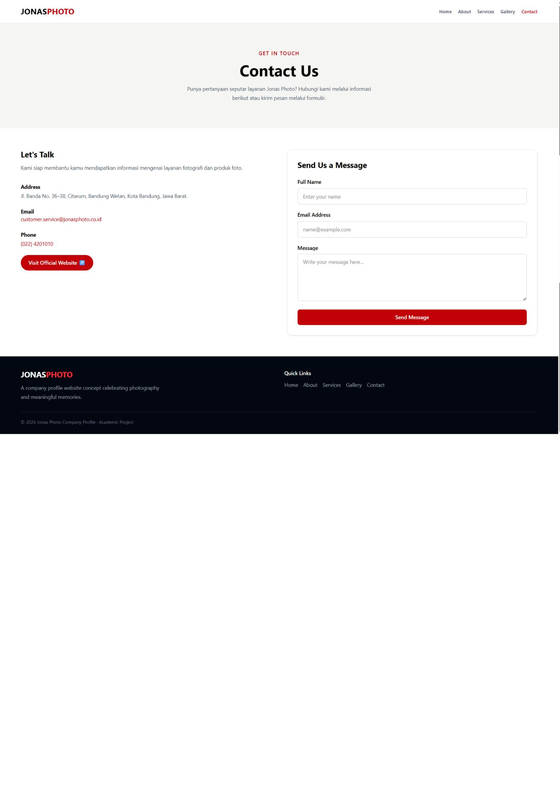

# Jonas Photo Company Profile

## Identitas Mahasiswa

- **Nama:** Sheila Nur Ashariyani
- **NIM:** 2505583
- **Kelas:** C
- **Program Studi:** Pendidikan Ilmu Komputer
- **Mata Kuliah:** Pemrograman 

## Deskripsi Website

Jonas Photo Company Profile merupakan website company profile yang dibuat sebagai proyek akademik menggunakan React, Vite, Tailwind CSS, dan React Router.

Website ini dirancang untuk memperkenalkan Jonas Photo, menampilkan informasi perusahaan, layanan fotografi, galeri foto, serta informasi kontak. Website memiliki lima halaman utama, yaitu Home, About, Services, Gallery, dan Contact, dengan tampilan responsif untuk berbagai ukuran layar.

## Teknologi yang Digunakan

- React
- Vite
- Tailwind CSS
- React Router
- JavaScript

## Cara Menjalankan Project

Pastikan Node.js sudah terinstal di komputer.

1. Clone atau download repository project.
2. Buka terminal pada folder project.
3. Jalankan perintah berikut untuk menginstal dependencies:

   ```bash
   npm install
   ```

4. Jalankan server pengembangan:

   ```bash
   npm run dev
   ```

5. Buka alamat lokal yang muncul di terminal, biasanya `http://localhost:5173/`.

## Screenshot Website

### 1. Home


Halaman utama yang menampilkan pengenalan Jonas Photo dan informasi singkat mengenai layanan perusahaan.

### 2. About



Halaman yang berisi informasi mengenai perusahaan, sejarah, dan nilai-nilai perusahaan.

### 3. Services



Halaman yang menampilkan daftar layanan fotografi dan layanan terkait.

### 4. Gallery



Halaman galeri yang menampilkan contoh foto dan karya fotografi.

### 5. Contact



Halaman kontak yang menyediakan informasi kontak dan formulir pesan.

## Catatan

Website ini dibuat untuk keperluan akademik. Website merupakan rancangan company profile dan tidak menyatakan sebagai website resmi Jonas Photo.